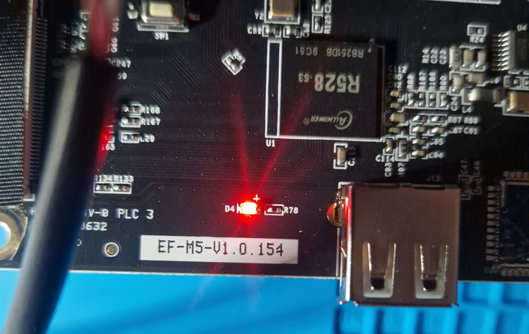
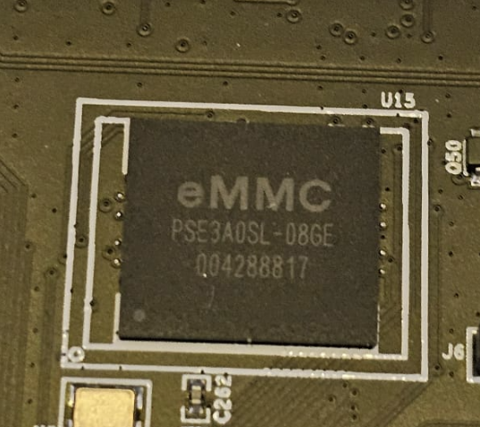

# Centauri 2 eMMC incompatibility

Some Centauri 2 units (not CC2) have been identified with an incompatible eMMC flash storage chip.
Before flashing COSMOS, please open the bottom panel and check your mainboard. These units can be
identified by the PCB revision number and the serial number printed on the eMMC chip itself.

!!! warning "Recovery process"
    If you've already flashed COSMOS to an affected board and are now stuck in a boot loop, read
    the [FEL & UART Bench Setup](../../../hardware/CC1/fel-uart-setup.md) and 
    [FEL Mode](../../../software/FEL-mode.md) pages for recovery steps.
    This will require a USB to serial converter, some jumper wires, and a modified USB cable.
    
    This process can be difficult for some users, if you're having trouble please reach out on
    the [OpenCentauri Discord server](https://discord.gg/t6Cft3wNJ3).

## Affected board identifiers

| PCB Revision   | eMMC Model    | eMMC Serial No. |
| -------------- | ------------- | --------------- |
| EF-M5-V1.0.154 | PSE3A0SL-08GE | 004288817       |

| PCB Revision                                                           | eMMC Chip Markings                                          |
| ---------------------------------------------------------------------- | ----------------------------------------------------------- |
|  |  |

If your eMMC chip is labelled "Rayson" or has a different serial number, it's not known to be
affected by this issue and you can proceed with COSMOS installation.